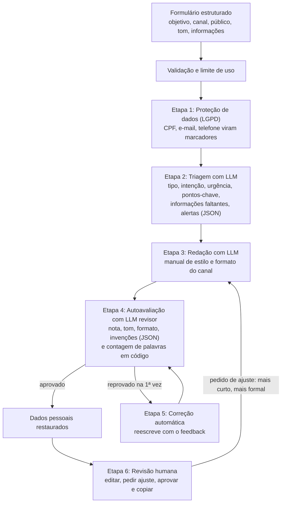

# Redige — Assistente Corporativo Inteligente

> Trabalho da disciplina **Fundamentos de IA com foco em IA Generativa**: *Seu Primeiro Agente de IA*.

**Demonstração:** https://assistente-corporativo.pages.dev
**Vídeo pitch:** https://www.loom.com/share/1d9c418ed9364d27ac12a4b3faa5263e

## O problema

Na empresa fictícia **Nova Rota Logística**, os colaboradores gastam tempo demais redigindo e-mails, comunicados, resumos de reunião e mensagens. Cada pessoa escreve de um jeito, então os textos saem sem padrão, longos demais, com tom inconsistente e precisam ser revisados antes de publicar.

## A solução

O **Redige** é um agente de IA Generativa. O colaborador preenche um formulário curto (objetivo, canal, público, tom e informações, que podem ser anotações soltas). O agente então executa um fluxo de várias etapas: protege os dados pessoais, entende a tarefa, escreve seguindo o manual de estilo da empresa, **avalia o próprio texto** e o reescreve sozinho se encontrar problemas. No fim, entrega um rascunho para **aprovação humana**.

Não é "abrir um chatbot e pedir um texto". Cada etapa tem instruções próprias, saídas estruturadas (JSON) e verificações automáticas.

## Fluxo da solução



O agente decide sozinho se reescreve: só aprova o próprio rascunho se a nota for ≥ 8, se não houver informação inventada, se o tom estiver adequado e se o texto estiver dentro do limite de palavras do canal. Ele faz no máximo uma reescrita automática e depois entrega ao humano de qualquer jeito, com os alertas visíveis.

## Ferramentas utilizadas

| Camada | Ferramenta | Por quê |
|---|---|---|
| Modelo de linguagem | **Google Gemini Flash-Lite** (API, plano gratuito) | Bom em português, rápido, gera JSON estruturado e tem cota gratuita |
| Modelo reserva | **Cloudflare Workers AI** (Llama 3.3 70B) | Entra sozinho se a cota do Gemini acabar, também sem custo |
| Aplicação | **Nuxt 4** (Vue + servidor Nitro) | Interface e servidor no mesmo projeto; a chave da API fica só no servidor |
| Hospedagem | **Cloudflare Pages** | Plano gratuito, URL pública com HTTPS |

## Principais prompts e instruções

Todos os prompts estão em [`server/utils/prompts.ts`](server/utils/prompts.ts).

- **Manual de estilo** (vai em todas as etapas): clareza, informação principal primeiro, pt-BR sem jargão, linguagem inclusiva, sempre dizer o que se espera do leitor, concisão.
- **Triagem**: papel de "módulo de triagem"; não escreve o texto, devolve um diagnóstico em JSON com esquema fixo.
- **Redação**: papel de "redator oficial", com regras obrigatórias:
  - usar **somente** os fatos informados;
  - quando faltar uma informação, escrever um marcador como `[DEFINIR DATA]` em vez de inventar;
  - respeitar o formato e o limite de palavras do canal;
  - copiar os marcadores de dados pessoais sem alterar.
- **Revisão**: papel de "revisor"; compara o rascunho com a solicitação e lista cada fato que não estava na entrada (detecção de alucinação).
- **Proteção contra prompt injection**: o texto do usuário vai entre tags `<informacoes>` e o modelo é instruído a tratá-lo como dado, nunca como instrução.

Cada canal tem um guia de formato e um limite de palavras próprios ([`shared/options.ts`](shared/options.ts)): e-mail, chat, comunicado interno, resumo de reunião e post de LinkedIn.

## Como usar

1. Abra a URL da demonstração.
2. Preencha o formulário ou clique num dos **exemplos** prontos.
3. Clique em **Gerar comunicação** e acompanhe as etapas do agente.
4. Leia o rascunho, os alertas e as sugestões do revisor. Complete os marcadores `[...]`.
5. Edite o texto ou peça ajustes ("Mais curto", "Mais formal" ou uma instrução livre).
6. Marque que revisou e clique em **Aprovar e copiar**.

## Rodando localmente

```bash
npm install
cp .env.example .env   # coloque sua chave do Gemini (https://aistudio.google.com/apikey)
npm run dev            # http://localhost:3000
```

Sem chave? Use `NUXT_AI_PROVIDER=mock` no `.env` para testar a interface com respostas simuladas.

```bash
npm test               # testes automatizados (privacidade, fluxo do agente, validação)
```

## Publicando no Cloudflare Pages (custo zero)

```bash
npx wrangler login
npx wrangler pages project create assistente-corporativo
npx wrangler pages secret put NUXT_GEMINI_API_KEY --project-name assistente-corporativo
npm run deploy
```

O binding `AI` do `wrangler.toml` ativa o Workers AI como reserva automática.

## Segurança, privacidade e uso responsável

- **LGPD**: CPF, CNPJ, e-mail, telefone e cartão são trocados por marcadores **antes** de chegar ao modelo e restaurados só no servidor. Nada é armazenado e o conteúdo não é registrado em logs.
- **Alucinações**: o revisor lista informações inventadas e o agente reescreve; o que faltar vira marcador visível para o humano.
- **Supervisão humana obrigatória**: o texto só pode ser copiado depois que o usuário confirma que revisou.
- **Abuso de custo**: há limite de requisições por IP e limite de tamanho da entrada.
- **Chave da API**: fica só no servidor, como segredo do Cloudflare.

A análise completa está em [`docs/parte-teorica.md`](docs/parte-teorica.md).

## Estrutura

```
app/                 interface (Vue)
  components/        formulário, fluxo do agente, painel de resultado
  composables/       leitura do fluxo em tempo real (NDJSON)
server/
  api/agent.post.ts  endpoint do agente
  utils/agent.ts     orquestração das etapas e laço de autoavaliação
  utils/prompts.ts   prompts e esquemas JSON
  utils/pii.ts       filtro de dados pessoais
  utils/llm.ts       Gemini, Workers AI e simulador
shared/              tipos e opções usados pelos dois lados
tests/               testes automatizados
docs/                parte teórica e roteiro do vídeo
```
